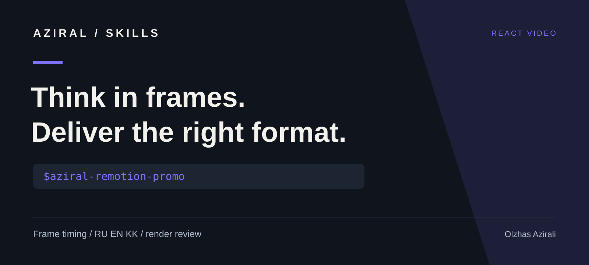

# AZIRAL skills for Remotion

An original agent workflow for localized app promos: one product action, a frame-based storyboard, layouts adapted to each aspect ratio, and a local visual review.



Created by [Olzhas Azirali / AZIRAL](https://aziral.com/olzhas-azirali). This project is independent and is not affiliated with or endorsed by Remotion. The repository name describes the engine the skill works with.

[Русская версия](README.ru.md)

## Install the skill

```bash
npx skills add azirali/remotion --skill aziral-remotion-promo
```

Installation adds workflow instructions for compatible coding agents. Set up the Remotion engine separately using its [official documentation](https://www.remotion.dev/docs/), or use an existing Remotion project.

## Use it

```text
Use $aziral-remotion-promo in my existing Remotion project.
Create a 12-second promo showing one useful action in my app.
Prepare separate Russian, English, and Kazakh versions in 9:16 and 16:9.
Use only the product claims and screenshots I provide.
Open a local preview, inspect the important frames, then export the MP4 files.
```

[examples/promo/brief.json](examples/promo/brief.json) describes a fictional notes app at 30 FPS with three editable scenes and three format presets. It is planning data, not a running video project or automatic renderer.

## What the workflow adds

- A scene plan tied to integer frames and an observable product action.
- Separate RU/EN/KK copy with font and reading-time checks.
- Layout decisions for portrait, landscape, and square compositions.
- Verification of the installed CLI before running commands.
- Local preview, frame inspection, and exported-file review.

The instructions and references live in [skills/aziral-remotion-promo](skills/aziral-remotion-promo).

## Attribution and licensing

[Remotion](https://github.com/remotion-dev/remotion) is the separate video engine maintained by the Remotion team. Its [official agent skills](https://www.remotion.dev/docs/ai/skills) are available from [remotion-dev/skills](https://github.com/remotion-dev/skills).

This repository contains original AZIRAL instructions and example planning data under the [MIT License](LICENSE). MIT covers these original files only. The engine, packages, fonts, media, and other dependencies retain their own licenses. Check [Remotion's current licensing terms](https://www.remotion.dev/docs/license/pricing) for your use. The workflow does not authorize paid subscriptions, license purchases, or cloud rendering without your approval.

## Contribute

Useful improvements include clearer examples, better language variants, and fixes supported by a reproduced layout or render problem. Include the engine version, language, format, and expected result. Share a minimal public example rather than private product data.

## More AZIRAL skills

[HyperFrames workflows](https://github.com/azirali/hyperframes) · [Remotion promos](https://github.com/azirali/remotion) · [Brand frontend](https://github.com/azirali/taste-skill) · [UI release review](https://github.com/azirali/impeccable)

If this workflow helps your work, a star helps other developers discover it.
